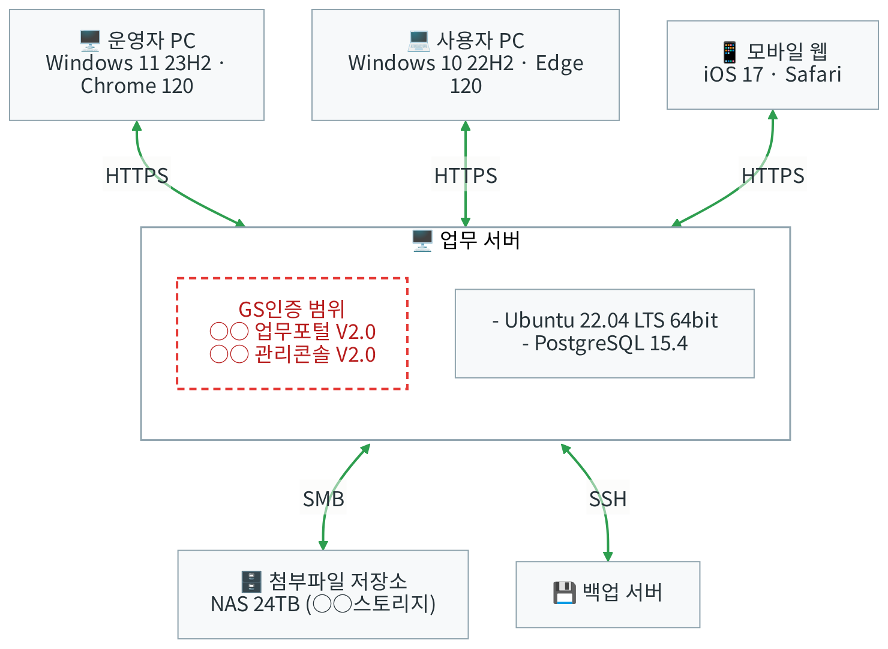
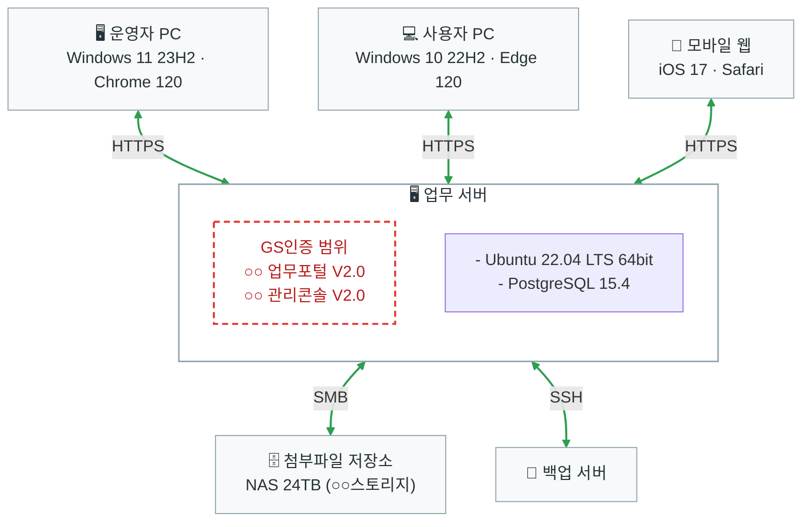
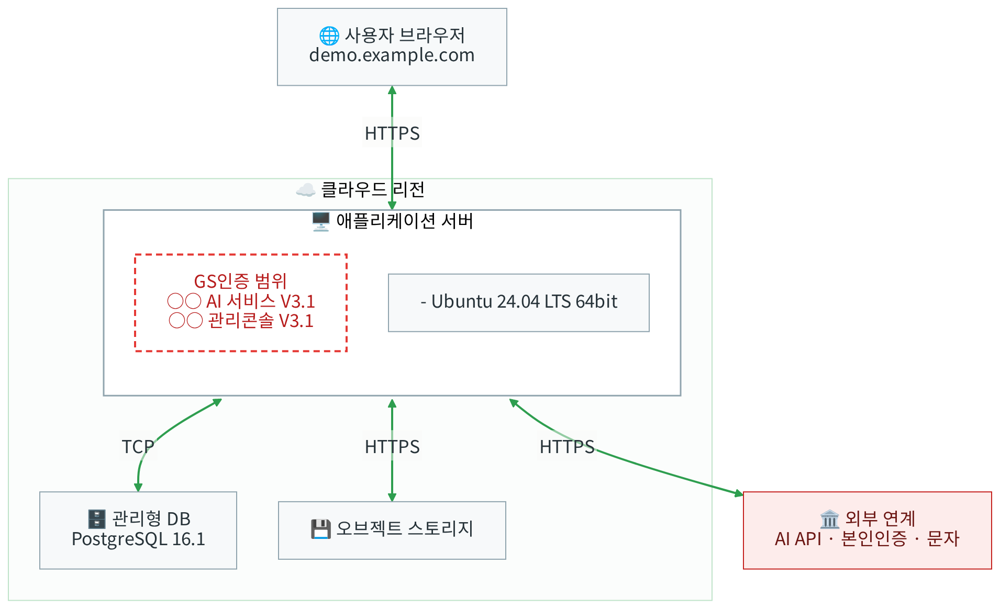
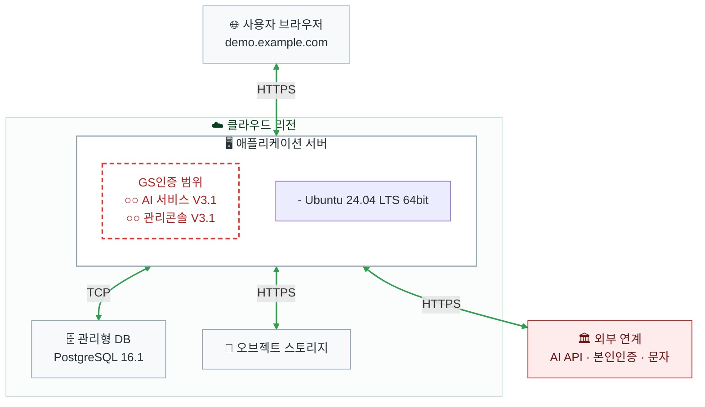
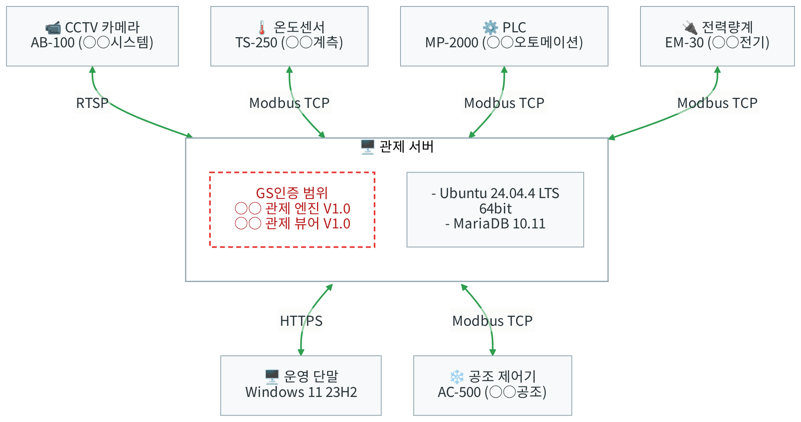
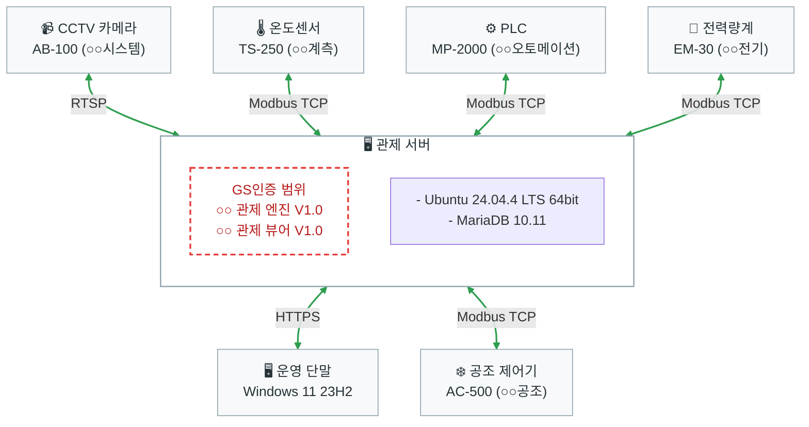

# 제품 설치 구성도 — 표기 규격 · 템플릿 · 웹 빌더

> GS인증 **제품설명서에 들어가는 "제품 설치 구성도"**를 그리는 기준입니다.
> 웹 도구([`tools/diagram-builder.html`](../tools/diagram-builder.html))에 값을 넣으면 같은 규격의 그림이 나오고,
> **파워포인트에서 도형·글자를 그대로 고칠 수 있는 `.pptx`**로 내려받을 수 있습니다.

- 바로 그리기: [`tools/diagram-builder.html`](../tools/diagram-builder.html) — 설치 없이 브라우저에서 실행
- AI로 뽑기: 아래 [AI 프롬프트 가이드](#ai-프롬프트-가이드--제품설명서--json) → 나온 JSON을 도구에 붙여넣기
- 코드로 그리기: [템플릿 1](#템플릿-1--표준-웹apidb-서버형) · [템플릿 2](#템플릿-2--클라우드ai-연계형) · [템플릿 3](#템플릿-3--cctviot-장비-연계형)
- 포트·계정이 들어가는 쪽은: [시험환경 구성도 (신청·사전확인용)](test-env-diagram.md)

---

## 먼저 — 두 가지 구성도를 구분합니다

같은 "구성도"라도 제출처가 다르면 그리는 방식이 다릅니다. 이 문서는 **왼쪽**을 다룹니다.

| | **② 제품 설치 구성도** (이 문서) | [**① 신청·시험환경 구성도**](test-env-diagram.md) |
| --- | --- | --- |
| 들어가는 곳 | 제품설명서, 사용자취급설명서 | 시험 접속 안내, 사전점검 자료 |
| 목적 | **제품이 어떤 장비 위에서 무엇과 통신하는지** 설명 | 평가자가 **그 자리에서 접속·재현**할 수 있게 안내 |
| 중심 | 물리적 객체(서버·단말·장비)와 프로토콜 | 계정·IP·포트·접속 절차 |
| 포트 번호 | **쓰지 않습니다** | IP:포트까지 표기 |

시험환경 쪽은 접속 정보(IP·계정·포트)가 본문이므로 [별도 문서](test-env-diagram.md)에서 다룹니다. 두 그림의 장비 이름·대수는 같게 맞춰 두세요.

---

## 5가지 표기 규격

이 다섯 가지만 지키면, 업체마다 다른 그림이어도 평가자가 같은 방식으로 읽습니다.

### ① 물리적 객체 중심 — "프로그램"이 아니라 "장비"를 그립니다

카드 하나가 **설치되는 실물 하나**입니다. 한 서버에서 여러 프로그램이 돌아도 서버 카드는 하나이고, 프로그램은 그 안에 적습니다.

| 이렇게 | 이렇게 쓰면 안 됨 |
| --- | --- |
| `관제 서버` 카드 1개 + 그 안에 `관제 엔진 V1.0`, `관제 뷰어 V1.0` | `엔진 서버`, `뷰어 서버`처럼 프로그램마다 카드를 나눔 |
| `CCTV 카메라` `온도센서` `PLC` 각각 카드 | `현장 장비` 상자 하나에 뭉쳐 표기 |
| 아이콘은 **선만 있는 단순 아이콘**(사진·로고 아님) | 제품 스크린샷·회사 로고를 카드에 붙임 |

> 카드에 넣는 것: **객체명** + (모델명) + (제조사). 대수 표기(`x3대`)나 `로컬 PC`, `동일 PC 내 2개 프로세스` 같은 설명은 넣지 않습니다.

### ② 양방향 연결선 — 양쪽 끝에 화살표

구성요소 사이는 **양쪽 끝에 화살표가 있는 연결선**으로 잇습니다. 요청·응답이 오가는 통신을 방향 하나로 단정하지 않기 위해서입니다.

| 이렇게 | 이렇게 쓰면 안 됨 |
| --- | --- |
| `PC ◀──▶ 서버` (양끝 화살표) | `PC ──▶ 서버` 한쪽 화살표만 |
| 연결선은 **한 가지 색**으로 통일 | 선마다 색을 달리해 계층처럼 보이게 |

> 방화벽 정책상 정말 단방향만 열려 있다면, 그 한 줄만 단방향으로 두고 **범례 아래에 이유를 한 줄 적습니다**. 그림과 설명이 어긋나는 것이 가장 흔한 지적 사항입니다.

### ③ 프로토콜만 — 포트 번호는 쓰지 않습니다

연결선 위에는 **통신 프로토콜 이름**만 흰 배경 라벨로 붙입니다. `HTTP`, `HTTPS`, `RTSP`, `Modbus TCP`, `MQTT`, `SMB`, `SSH`처럼요.

| 이렇게 | 이렇게 쓰면 안 됨 |
| --- | --- |
| `HTTPS` | `HTTPS 443`, `TCP 8080` |
| `Modbus TCP` | `502`, `Modbus TCP/502` |
| `비상전원` (통신이 아닌 연결은 용도로) | `전원` 화살표만 있고 설명 없음 |

> 포트·IP는 제품설명서의 **환경표(설치 환경)** 쪽에 적습니다. 구성도는 "무엇과 무엇이 무슨 규약으로 이야기하는가"까지만 보여 줍니다.

### ④ GS인증 범위 — 빨간 점선 박스

**제품이 실제로 설치되는 서버 카드 안**에, 인증 대상 소프트웨어 이름과 버전을 적고 **빨간 점선(`#e53935`) 네모 박스**로 묶습니다. 박스에는 `GS인증 범위` 라벨을 붙입니다.

- 박스 **안**: 제품 소프트웨어명 + 버전 (`○○ 관제 엔진 V1.0`)
- 박스 **밖, 서버 카드 안 또는 옆**: OS·DBMS 등 인증 대상이 아닌 소프트웨어 (`- Ubuntu 24.04 LTS 64bit`, `- MariaDB 10.11`)

| 이렇게 | 이렇게 쓰면 안 됨 |
| --- | --- |
| 서버 카드 안에 점선 박스 + SW명·버전 | 점선 없이 "인증 대상"이라고 글자로만 |
| OS·DBMS는 점선 밖 | OS·DBMS까지 점선 안에 넣어 범위를 넓힘 |
| 박스 안에 **제품 SW만** | 라이선스가 걸린 서드파티 솔루션을 범위 안에 |

> 범위 판단은 인증기관 확인이 필요한 영역입니다. 애매한 구성요소는 점선 밖에 두고 문서에 따로 적는 편이 안전합니다.

### ⑤ 범례 — 두 줄이면 충분합니다

그림 아래에 **양방향 통신선**과 **GS인증 범위** 두 가지를 반드시 표시합니다. 처음 보는 사람이 그림만 보고 읽을 수 있어야 합니다.

```
범례  ◀──▶ 구성요소 간 통신 (양방향)      ┏┄┄┓ GS인증 범위
```

---

## 3분 만에 그리기 (웹 도구)

1. [`tools/diagram-builder.html`](../tools/diagram-builder.html)을 엽니다. (GitHub Pages에 올려 두면 링크만으로 열립니다.)
2. **프리셋 ① 표준 웹·API·DB 서버형** 또는 **② CCTV·IoT 장비 연계형**을 눌러 뼈대를 잡습니다.
3. 왼쪽에서 객체명·모델명·제조사·프로토콜을 실제 값으로 바꿉니다.
   - 중앙 서버 카드의 **인증 범위 SW** 칸에 제품 소프트웨어명·버전을 한 줄씩
   - **인증 범위 밖 SW** 칸에 OS·DBMS를 한 줄씩
4. 오른쪽 **PPTX 다운로드** → 파워포인트에서 열어 위치·글꼴만 다듬습니다. (SVG·PNG 저장도 있습니다.)

> 도구는 **모델명·제조사/SW 표시를 끄는 순간** 객체명만 남는 버전으로 바뀝니다. 같은 구성의 두 버전(전체 표기 / 객체명만)을 만들 때 그대로 쓰세요.
> PPTX는 도형·텍스트·양방향 화살표·빨간 점선 박스가 **각각 개별 객체**로 들어가서, 파워포인트에서 하나씩 고칠 수 있습니다.
> PPTX 변환기는 CDN에서 한 번 받아옵니다(jsDelivr → unpkg 순서). 사내망에서 CDN이 막히면 PPTX 버튼만 동작하지 않고, **SVG·PNG 저장은 그대로 됩니다**.

---

## AI 프롬프트 가이드 — 제품설명서 → JSON

구성도 데이터를 손으로 정리하기 번거로울 때, **ChatGPT·Claude에 제품설명서(또는 제품 설명)와 함께** 아래 프롬프트를 붙여넣습니다. 결과 JSON을 도구의 **JSON 붙여넣기 → JSON 적용**에 넣으면 그림이 나옵니다.

```text
아래 규칙으로 GS(소프트웨어 품질인증) 제품설명서에 넣을 "제품 설치 구성도" 데이터를 만들어 줘.
첨부한 제품설명서(또는 아래에 붙여넣은 제품 설명)만 근거로 쓰고, 확인되지 않은 값은 추측하지 말고 비워 둬.
결과는 설명 문장이나 코드블록 표시 없이 JSON 객체 하나만 출력해.

[작성 규칙]
1. 구성요소는 물리적 객체 단위로 나눈다. 서버·단말·카메라·센서·PLC·스위치 같은 설치 장비가 단위이고, 한 서버에서 실행되는 프로그램은 구성요소로 만들지 않고 그 서버의 sw에 넣는다.
2. 중앙이 되는 서버 1대의 pos는 "center", 나머지는 "top" 또는 "bottom"으로 둔다. (top/bottom 각각 4개 이하로 유지)
3. icon은 다음 중 하나만: server, pc, mobile, camera, sensor, plc, meter, gateway, cloud, db, storage, switch, firewall, ups, aircon, inverter, terminal, printer, ai
4. links에는 실제 통신이 있는 연결만 넣고, protocol은 HTTP, HTTPS, RTSP, Modbus TCP, MQTT, SMB, SMTP처럼 프로토콜 이름만 쓴다. 포트 번호는 쓰지 않는다.
5. sw는 GS인증 범위에 들어가는 제품 소프트웨어 이름과 버전을 한 줄씩 적는다. 예: "○○ 관제 엔진 V1.0"
6. otherSw는 인증 범위 밖 소프트웨어(OS, DBMS 등)를 "- Ubuntu 24.04 LTS 64bit" 형식으로 적는다.
7. model과 vendor는 제품설명서 장비 표에 적힌 그대로 쓴다. 표에 없으면 빈 문자열로 두고 마지막에 알려 준다.
8. 확인되지 않은 값은 빈 문자열 또는 빈 배열로 두고, 어떤 값을 채우지 못했는지 짧게 알려 준다.

[JSON 스키마]
{
  "productName": "제품명",
  "version": "V1.0",
  "subtitle": "제품설명서 · 설치 구성도",
  "nodes": [
    { "id": "cctv1", "name": "CCTV 카메라", "icon": "camera", "pos": "top", "model": "AB-100", "vendor": "○○시스템", "sw": [], "otherSw": [] },
    { "id": "srv", "name": "관제 서버", "icon": "server", "pos": "center", "model": "", "vendor": "",
      "sw": ["○○ 관제 엔진 V1.0", "○○ 관제 뷰어 V1.0"], "otherSw": ["- Ubuntu 24.04 LTS 64bit", "- MariaDB 10.11"] }
  ],
  "links": [
    { "from": "cctv1", "to": "srv", "protocol": "RTSP" }
  ]
}
```

### JSON 필드

| 필드 | 뜻 | 비고 |
| --- | --- | --- |
| `productName` · `version` | 제품명·버전 | 도면 제목이 됩니다 |
| `nodes[].name` | 객체명 | 제품설명서에 쓴 이름 그대로 |
| `nodes[].icon` | 아이콘 종류 | 아래 목록 중 하나 |
| `nodes[].pos` | 배치 | `center`(중앙 서버) · `top` · `bottom` · `left` · `right` |
| `nodes[].model` · `vendor` | 모델명·제조사 | 장비 표에 없으면 빈 문자열 |
| `nodes[].sw` | **인증 범위 안** 소프트웨어 | 점선 박스 안에 표시 |
| `nodes[].otherSw` | **인증 범위 밖** 소프트웨어 | `- `로 시작하는 줄 |
| `links[].from` · `to` | 연결할 `id` | 두 값이 모두 있어야 그려집니다 |
| `links[].protocol` | 프로토콜 이름 | 포트 번호 금지 |

**아이콘 목록** — `server` `pc` `mobile` `camera` `sensor` `plc` `meter` `gateway` `cloud` `db` `storage` `switch` `firewall` `ups` `aircon` `inverter` `terminal` `printer` `ai`

### 프롬프트를 쓸 때

- **한 번에 믿지 마세요.** 첫 결과에서 `sw`·`otherSw`가 뒤섞이거나 없는 모델명이 채워지는 일이 흔합니다.
  "확인되지 않은 값은 비워 둬"를 넣어도 모델이 추측할 때가 있으니, 제품설명서 장비 표와 한 줄씩 대조하세요.
- **두 번째 요청으로 범위를 확정**합니다. 예: "인증 범위는 제품명에 포함된 모듈만. OS·DBMS·서드파티는 otherSw로."
- **없는 장비를 지우게** 하세요. "제품설명서에 없는 장비는 넣지 말고, 실제 설치 구성만 남겨 줘."
- 결과가 마음에 안 들면 JSON을 손보는 게 프롬프트를 고치는 것보다 빠릅니다. 도구에서 **[현재 구성 JSON 복사]** 로 지금 상태를 받아 AI에게 "이 JSON에서 ~를 고쳐 줘"라고 요청해도 됩니다.

> ⚠️ 제품설명서 원문을 외부 AI 서비스에 붙여넣을 때는 조직의 보안 규정을 먼저 확인하세요. 공개된 제품설명서가 아니라면, 장비 목록·프로토콜만 옮겨 적어 넣는 편이 안전합니다.

---

## 템플릿 1 · 표준 웹/API/DB 서버형

브라우저에서 접속해 쓰는 업무 시스템·포털·관리 콘솔의 기본형입니다. 중앙 서버 한 대에 제품 소프트웨어가 올라가고, 사용자 단말이 HTTPS로 접속합니다.





**바꿔야 하는 것**

| 카드 | 확인할 값 |
| --- | --- |
| 사용자 단말 | OS·브라우저 버전을 **화면 캡처와 같은 문자열**로 |
| 업무 서버 | 제품 소프트웨어명 + 버전(점선 안), OS·DBMS 버전(점선 밖) |
| 저장소·백업 | 실제 쓰는 프로토콜(SMB·NFS·SSH)만. 백업이 없으면 카드를 지웁니다 |

---

## 템플릿 2 · 클라우드/AI 연계형

클라우드에 올린 서비스나 외부 AI·기관 시스템과 연동하는 제품입니다. **"우리 서버"만 그리면 재현이 안 되므로**, 외부 구간을 어디까지 제품 범위로 보는지 그림에 드러냅니다.





**클라우드·AI 연계에서 평가자가 특히 보는 것**

| 확인 항목 | 흔한 착오 |
| --- | --- |
| 외부 SaaS(AI API)를 인증 범위에 넣는지 여부 | 그림에는 있는데 문서에 정의가 없어 "기능이 문서에 없다"로 지적 |
| 시험 시 실제 과금 API를 호출하는지, 모의 응답으로 대체하는지 | 호출 비용·응답 변동으로 재현 실패 |
| 관리형 서비스의 버전 표기 | "관리형 DB 사용"만 적고 PostgreSQL 버전 미기재 |
| 범위 밖 연계를 점선·다른 색으로 구분했는지 | 외부 인증·문자가 실서비스로 연결 |

---

## 템플릿 3 · CCTV·IoT 장비 연계형

카메라·센서·PLC 같은 **현장 장비가 여럿 붙는 제품**입니다. 카드가 가장 많아지므로 객체명을 짧게 쓰고, 프로토콜이 갈리는 지점을 정확히 표시합니다.





**장비가 많은 제품에서 자주 나오는 지적**

- **장비가 5대를 넘으면** 같은 종류는 대표 1대만 그리고, 나머지 수량·모델은 아래 표에 적습니다. (카드에 `x3대`를 쓰지 않는다는 규칙과 같은 이유입니다.)
- **RTSP·Modbus TCP가 섞이는 제품**은 프로토콜별로 선을 구분해 달라는 요구가 있습니다. 이때도 선 색은 하나로 두고 라벨로만 구분합니다.
- **전원만 연결된 장비**(UPS 등)는 통신선과 같은 색으로 두되 라벨을 `비상전원`처럼 용도로 쓰고, 범례 아래에 "데이터 통신 없음"을 한 줄 적습니다.

---

## Mermaid로 직접 그릴 때

도구를 쓰지 않고 마크다운에서 바로 그리는 경우의 문법만 정리합니다.

| 규격 | Mermaid 표기 |
| --- | --- |
| 양방향 연결선 | `A <--> B` |
| 서버 박스 | `subgraph SRV["🖥️ 업무 서버"]` … `end` |
| GS인증 범위 점선 | `style SW fill:#ffffff,stroke:#e53935,stroke-width:2px,stroke-dasharray:6 4` |
| 연결선 한 색 | `linkStyle default stroke:#2e9e4f,stroke-width:2px` |

프로토콜 라벨을 붙인 연결선은 이렇게 씁니다(표 안에서는 `|`가 칸 구분자로 먹히므로 코드 블록으로 적습니다).

```text
PC1 <-->|"HTTPS"| SRV
SRV <-->|"SMB"| NAS
```

- 점선 박스는 **서버 `subgraph` 안에 만든 노드 하나**(예: `SW["GS인증 범위<br/>○○ 업무포털 V2.0"]`)에 `stroke-dasharray`를 주는 방식이 가장 안정적입니다. 렌더러(버전·뷰어)에 따라 상자 안 상자를 그리면 여백이 크게 생기기 때문입니다.
- 상자 테두리로 감싸고 제목을 따로 두고 싶으면, 서버 `subgraph` 안에 `subgraph GS["GS인증 범위"]`를 한 번 더 넣는 방법도 있습니다. 이때는 상자가 내용보다 크게 늘어날 수 있습니다.
- 라벨에 `(`, `)`, `:`, `/`가 들어가면 큰따옴표로 감쌉니다. 예: `A["카메라 (RTSP)"]`
- GitHub·GitLab·Notion은 코드 블록 언어를 `mermaid`로 두면 그대로 렌더링됩니다. PDF·오피스 제출본은 웹 도구에서 PPTX/SVG로 받는 편이 깔끔합니다.

---

## 제출 전 체크포인트

| # | 확인 항목 | 흔한 불일치 |
| --- | --- | --- |
| 1 | 그림의 객체명 = 제품설명서 장비 표의 이름 | 그림 "관제 서버", 표 "운영 서버" |
| 2 | 점선 안 소프트웨어명·버전 = 캡처 화면의 표기 | 그림 `V1.0`, 캡처 `1.0.3` |
| 3 | OS·DBMS가 점선 **밖**에 있는가 | OS까지 범위 안에 넣음 |
| 4 | 모든 연결선이 양방향이고 라벨에 프로토콜이 있는가 | 라벨 없는 선, 포트 번호 표기 |
| 5 | 범례에 통신선·GS인증 범위가 모두 있는가 | 범례 없음 |
| 6 | 그림에 없는 장비가 본문에만 나오지 않는가 | 본문에 "백업 서버" 언급, 그림엔 없음 |
| 7 | 모델명·제조사가 장비 표와 한 글자도 다르지 않은가 | `MySQL` / `Mysql` |
| 8 | 인증 범위 밖 기능·메뉴가 그림에 섞이지 않았는가 | 범위 밖 관리자 기능 카드 |

---

## 자주 하는 실수 (Before / After)

| Before | After |
| --- | --- |
| 서버마다 프로그램 이름을 붙여 카드 5개 | 실제 서버 수만큼 카드 + 안에 소프트웨어 나열 |
| `HTTPS 443`, `TCP 8080` | `HTTPS`, `HTTP` |
| 한쪽 화살표로 통신 방향 단정 | 양방향 연결선 |
| "인증 대상"이라는 글자만 | 빨간 점선 박스 + SW명·버전 + 범례 |
| 캡처 이미지 한 장 | 도형·텍스트로 된 PPTX(수정·검색 가능) |
| 장비 카드에 `x3대` | 대표 1대 + 수량은 표에 |

---

## 공식 접수 · 문의

이 문서와 도구는 **비공식 실무 자료**입니다. 인증 범위·시험환경 구성의 최종 확인은 공식 창구에서 받으세요.

- KTL GS인증 안내·절차: <https://customer.ktl.re.kr/web/contents/K101010800.do>
- 신청·견적 문의: **gs@ktl.re.kr** · 대표 상담 **080-808-0114**
- 접수 창구: 한국산업기술시험원 IT융합기술센터 (서울특별시 구로구 디지털로26길 87)

<sub>**면책** — 이 문서는 개인 실무 관점의 비공식 자료이며, KTL 및 다른 인증기관의 공식 안내서가 아닙니다. 그림의 제품명·모델명·제조사·버전은 모두 가상의 예시값입니다. 인증 기준과 시험환경 요구사항은 인증기관 안내를 확인하세요.</sub>
