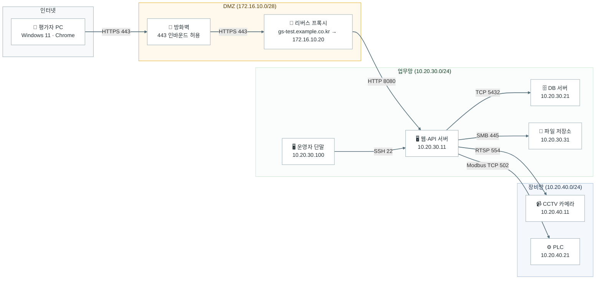

# 시험환경 구성도 — 신청·사전확인용 (네트워크·포트 포함)

> **① 신청·시험환경 사전확인용 구성도**입니다. 접수 전 상담·사전점검, 시험 접속 안내, 방화벽 오픈 요청서에 붙이는 그림입니다.
> 제품설명서에 들어가는 **② 제품 설치 구성도**와는 목적이 다르므로 따로 그립니다 — 제품 쪽은 [제품 설치 구성도 규격](architecture-diagrams.md)을 보세요.

- 이 문서에서 다루는 것: 망 구간, **IP·포트**, 접속 계정, 재현 가능한 시험 데이터
- 이 문서에서 다루지 않는 것: 제품의 기능·아키텍처 설명(제품설명서 쪽), 인증 범위 판정(인증기관 확인)

---

## 두 구성도의 차이

| | **① 신청·시험환경 구성도** (이 문서) | **② 제품 설치 구성도** ([다른 문서](architecture-diagrams.md)) |
| --- | --- | --- |
| 들어가는 곳 | 접수 전 상담·사전점검 자료, 시험 접속 안내, 방화벽 요청서 | 제품설명서(§10⑩ 설치 절차·구성), 사용자취급설명서 |
| 목적 | 평가자가 **그 자리에서 접속·재현**할 수 있게 | 제품이 **어떤 장비 위에서 무엇과 통신하는지** 설명 |
| 단위 | 접속 경로(출발지 → 목적지) | 물리적 객체(서버·단말·장비) |
| IP·포트 | **IP:포트까지 표기**(본문) | 쓰지 않음(프로토콜만) |
| 화살표 | 접속이 시작되는 방향으로 **단방향** | **양방향** |
| 계정 | 그림에는 역할, 값은 표로 | 다루지 않음 |

> 두 문서가 서로 어긋나면 "그림에 있는데 접속이 안 된다"는 지적이 나옵니다. **장비 이름과 대수는 두 그림에서 같게** 유지하고, 포트·계정은 이 문서에만 적습니다.

---

## 표기 규칙 6가지

### ① 망 구간을 먼저 나눈다

인터넷 / DMZ / 업무망 / 장비망처럼 **구간을 상자로 나누고 대역(`10.20.30.0/24`)을 제목에 적습니다.** 평가자는 "내 PC가 어디서 어디로 들어가는지"를 먼저 확인합니다.

| 이렇게 | 이렇게 쓰면 안 됨 |
| --- | --- |
| `subgraph 업무망 (10.20.30.0/24)` 안에 서버 카드 | 서버 카드만 늘어놓고 망 구간 표기 없음 |
| DMZ·업무망을 각각 상자로 | "내부 서버" 상자 하나에 전부 |

### ② 접속 경로에는 IP와 포트를 적는다

연결선 라벨에 **목적지 포트**를 적고, 카드에는 **IP**를 적습니다. 도메인으로 접속한다면 도메인과 실제 목적지 IP를 함께 둡니다.

| 이렇게 | 이렇게 쓰면 안 됨 |
| --- | --- |
| 카드 `웹·API 서버 10.20.30.11` + 선 라벨 `HTTPS 443` | 선 라벨 `HTTPS`만 (포트 없음) |
| `https://gs-test.example.co.kr` → `10.20.30.11:443` | 도메인만 적고 목적지 IP 없음 |

### ③ 화살표는 접속을 시작하는 쪽에서

**접속을 거는 쪽 → 받는 쪽**으로 단방향 화살표를 씁니다. 이 방향이 방화벽 정책·오픈 요청서와 같아야 평가자가 그대로 따라갈 수 있습니다.

> 제품 설치 구성도는 양방향이 규격이지만, **시험환경 도표는 예외**입니다. 통신이 실제로 양방향인 구간이라도 정책이 단방향이면 단방향으로 그리고 범례에 한 줄 적습니다.

### ④ 방화벽·VPN·NAT·프록시는 지우지 않는다

"접속이 되는데 재현이 안 된다"의 답은 대개 이 장비들에 있습니다. 그리지 않으면 평가자는 어디서 막히는지 알 수 없습니다.

- 방화벽: 허용한 **출발지 → 목적지·포트**를 라벨에
- 리버스 프록시: 공인 도메인 ↔ 내부 IP 변환 관계를 라벨에
- VPN: 2차 접속 경로가 있으면 별도 선으로, "장애 시 대체 경로" 표시

### ⑤ 계정은 그림에 쓰지 않고 표로

그림 카드에는 `평가자 계정`, `관리자 계정`처럼 **역할만** 적고, 실제 아이디·권한·잠금 정책은 아래 표에 정리합니다. 그림에 비밀번호나 계정 문자열을 직접 쓰면 캡처·공유 과정에서 그대로 노출됩니다.

### ⑥ 고정값과 변경값을 구분한다

시험 기간 중 바뀌면 재현이 깨지는 값(IP·포트·계정)과 매일 초기화되는 값(시험 데이터)을 표에서 나눠 적습니다.

---

## 예시 · 사전점검 제출용 네트워크 도표

**범례** `──▶` 접속 방향(출발지 → 목적지) · 라벨은 `프로토콜 포트` · 노란 상자 DMZ · 화살표가 없는 구간은 포트 미오픈

> 위 IP·도메인은 모두 가상의 예시값입니다. 실제 제출본에는 환경표의 값을 그대로 옮기고, 대외 공유본에서는 조직 규정에 따라 **대역만 남기고 호스트 IP를 가리는** 판본을 함께 준비하세요.

---

## 접속 정보표 (같이 내는 표)

그림만으로는 부족합니다. 같은 문서에 아래 표를 붙입니다.

| 구분 | 값 | 비고 |
| --- | --- | --- |
| 접속 URL | `https://gs-test.example.co.kr` | 공인 도메인 · 유효기간 표기 |
| 목적지 IP:포트 | `10.20.30.11:443` | 리버스 프록시 경유 |
| 오픈 포트 목록 | 평가자 PC → DMZ `443` / 웹 서버 → DB `5432`, 파일 저장소 `445` | 방화벽 신청 승인번호 함께 |
| 평가자 계정 | 역할 `평가자` · 일반 권한 | 발급 수량·잠금 정책 |
| 관리자 계정 | 역할 `관리자` · 전체 권한 | 시험 중에만 활성 |
| 서버 OS · DBMS | `Ubuntu 24.04 LTS` · `PostgreSQL 16.1` | 제품설명서 환경표와 같은 표기 |
| 시험 데이터 초기화 | 매일 `03:00` 자동 초기화 / 수동 스크립트 제공 | 초기 상태 캡처 포함 |
| 외부 연계 | 문자·본인인증은 **모의 응답 서버**로 대체 | 실계정 사용 여부 명시 |
| 대체 접속 경로 | VPN `vpn.example.co.kr` | 주 경로 장애 시 |
| 시험 중 연락처 | 담당자 · 기술 담당자(휴대전화) | 시험 시간대 응대 가능 시간 |

> 계정 비밀번호는 표에 적지 않고 **별도 전달 절차**(접수 담당자 메일·보안 채널)로 안내합니다. 문서에 남긴 비밀번호는 시험 이후에도 계속 남습니다.

---

## 사전점검 체크리스트

접수 전 상담·사전점검을 요청했다면, 아래 항목을 **실제로 해보고** 결과를 적습니다.

- [ ] **사내망 밖에서** 접속해 봤다 (평가자와 같은 조건 — 회사 PC·내부 VPN 아님)
- [ ] 평가자용 계정을 **실제로 발급해 로그인**해 봤다 (권한 누락·최초 비밀번호 변경 강제 확인)
- [ ] 계정 잠금 정책을 확인했다 (연속 실패 시 잠금 여부·해제 절차)
- [ ] 방화벽 오픈을 **신청·승인 완료**했고, 승인 범위와 그림의 포트가 일치한다
- [ ] 공인 인증서가 유효하고 만료일이 시험 기간 이후다 (사설 인증서면 설치 안내 포함)
- [ ] 도메인 DNS가 사내에서도 외부에서도 같은 IP로 해석된다
- [ ] 시험 데이터를 **초기 상태로 되돌리는 방법**이 문서화되어 있다 (스크립트·백업본)
- [ ] 백업·복구 시나리오를 같은 방법으로 한 번 재현해 봤다
- [ ] 장비(카메라·센서·PLC)가 시험 기간 내내 전원·네트워크가 유지된다 (원격 재시작 수단 포함)
- [ ] 외부 연계(문자·AI API·본인인증)가 시험 중 과금·한도에 걸리지 않는다 (모의 응답 여부 결정)
- [ ] 시험 화면과 문서의 **버전 문자열**이 같다 (캡처 시점 재확인)
- [ ] 시험 중 연락 가능한 담당자·기술 담당자와 응대 시간대를 정했다
- [ ] 화면 캡처·녹화에 개인정보가 찍히지 않도록 시험용 데이터로만 구성했다

---

## 자주 나오는 지적

| Before | After |
| --- | --- |
| 그림은 있는데 외부에서 접속이 안 됨 | 사내망 밖에서 접속 시험 후 결과를 문서에 한 줄 추가 |
| `HTTPS` 라고만 적음 | `HTTPS 443` + 목적지 IP |
| 방화벽이 그림에 없음 | 방화벽 카드 + 허용 포트 라벨 + 승인번호 |
| 계정이 그림 카드에 그대로 적힘 | 그림엔 역할, 값은 표 + 별도 전달 |
| "데이터는 초기화됩니다"만 적음 | 초기화 시각·방법·초기 상태 캡처 |
| 시험 중 담당자 연락 두절 | 응대 시간대와 대체 연락처를 표에 |
| 외부 AI·문자 연계가 실서비스로 연결 | 모의 응답 서버 또는 한도·과금 조건 명시 |

---

## 공식 접수 · 문의

이 문서는 **비공식 실무 자료**입니다. 시험환경 요구사항과 사전점검 가능 여부는 공식 창구에서 확인하세요.

- KTL GS인증 안내·절차: <https://customer.ktl.re.kr/web/contents/K101010800.do>
- 신청·견적 문의: **gs@ktl.re.kr** · 대표 상담 **080-808-0114**
- 접수 창구: 한국산업기술시험원 IT융합기술센터 (서울특별시 구로구 디지털로26길 87)

**면책** — 이 문서는 개인 실무 관점의 비공식 자료이며, KTL 및 다른 인증기관의 공식 안내서가 아닙니다. 그림의 IP·도메인·계정·모델명은 모두 가상의 예시값입니다. 시험환경 구성과 포트 정책의 최종 확인은 인증기관과 조직의 보안 규정을 따르세요.
